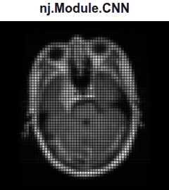

# CNN: brain tumor MRI

A separate content variant of the approved CNN animation. The 240px square,
heading, scan timings and four in-place pooling passes are retained; the final
prediction is a tumor-type name in bold Arial.

See [training, evaluation, data attribution and reproduction](../neuroscience/README.md).
Open `index.html` for live playback or use `../assets/cnn_brain_mri.html` as a
self-contained asset. These render cached predictions and illustrative pooling,
not live inference or intermediate convolutional features.
