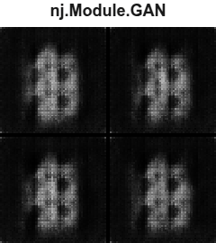

# GAN: brain MRI generation

A separate content variant of the approved GAN animation. The square panel,
heading, relative tile gap and continuously cycling 2 × 2 batches are retained.
Three batches show the first 12 fixed latent vectors across training checkpoints.

See [training, quality checks, data attribution and reproduction](../neuroscience/README.md).
Open `index.html` for live playback or use `../assets/gan_brain_mri.html` as a
self-contained asset. The morph depicts training progress, not iterative inference.
